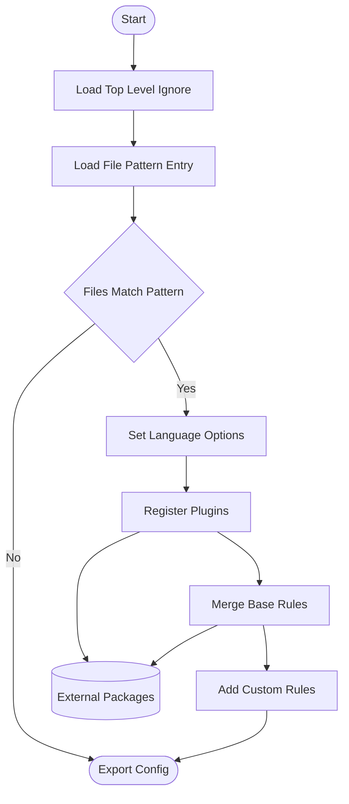

> **[ADDED]** — New file since last run (2026-03-05)

# eslint.config.js

## Summary
This file defines an ESLint configuration exported as the default array for the frontend project. It sets a top-level ignore, applies language options and plugins for JS and JSX files, and composes rule sets by merging `@eslint/js` and `eslint-plugin-react-hooks` recommended rules plus a few project-specific overrides.



## Core Functionality

### Default export array
Purpose: Export an ESLint configuration array containing ignore entries and file-specific overrides.
```javascript
export default [
  { ignores: ['dist'] },
  {
    files: ['**/*.{js,jsx}'],
    languageOptions: { ... },
    plugins: { ... },
    rules: { ... },
  },
]
```
Explanation: The config array has two items: a simple ignore pattern and an override object that applies to JS and JSX files.

### Language options block
Purpose: Configure parser and environment for matched files.
```javascript
languageOptions: {
  ecmaVersion: 2020,
  globals: globals.browser,
  parserOptions: {
    ecmaVersion: 'latest',
    ecmaFeatures: { jsx: true },
    sourceType: 'module',
  },
},
```
Explanation: Sets ECMAScript target, browser globals from `globals`, enables JSX, and marks source type as module.

### Plugins registration
Purpose: Attach plugin implementations used by rules.
```javascript
plugins: {
  'react-hooks': reactHooks,
  'react-refresh': reactRefresh,
},
```
Explanation: Registers `eslint-plugin-react-hooks` and `eslint-plugin-react-refresh` instances imported at top level.

### Rules composition and overrides
Purpose: Merge recommended base rules and add project-specific rule tweaks.
```javascript
rules: {
  ...js.configs.recommended.rules,
  ...reactHooks.configs.recommended.rules,
  'no-unused-vars': ['error', { varsIgnorePattern: '^[A-Z_]' }],
  'react-refresh/only-export-components': [
    'warn',
    { allowConstantExport: true },
  ],
},
```
Explanation: Spreads recommended rule sets from `@eslint/js` and `react-hooks`, then applies customizations: ignore unused variable errors for names starting with uppercase or underscore, and warn for `react-refresh` export rules while allowing constant exports.

## Improvement Recommendations
- Replace spread-merging of external config objects with `extends` style or explicit rule selection to avoid unexpected rule collisions when plugin rule shapes change; this improves maintainability and clarity.
- Add explicit parser selection (for example `parser: '@babel/eslint-parser'` or `@typescript-eslint/parser` when TS is used) and a clear comment explaining `ecmaVersion` duplication to avoid confusion between top-level and parserOptions settings.
- Add an `overrides` entry for test files and config files (patterns like `**/*.test.{js,jsx}` and config files) to relax or tighten rules as appropriate and include `argsIgnorePattern` for function arguments if needed.

<!--S2D_RUNTIME_SERVICES:{"services":[]}-->