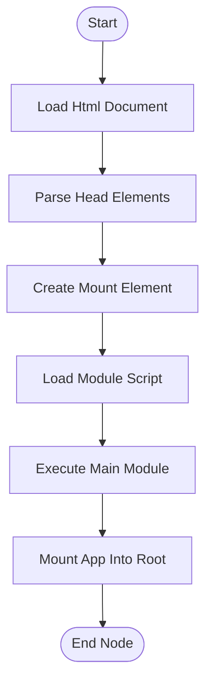

> **[ADDED]** — New file since last run (2026-03-05)

# index.html

## Summary
This HTML file provides the minimal application shell for a single-page frontend named "Japanese Flashcards". It defines document metadata, a mount point div with id "root", and loads the client application by importing the module at /src/`main.jsx` so the JavaScript app can initialize and render into the page.



## Core Functionality

### Document Shell
- Purpose: Provide basic HTML structure and metadata for the app.
```html
<!DOCTYPE html>
<html lang="en">
<head>
  <meta charset="UTF-8" />
  <meta name="viewport" content="width=device-width, initial-scale=1.0" />
  <title>Japanese Flashcards</title>
  ...
</head>
```
- Explanation: Sets character encoding, responsive viewport, and page title so the browser can render the app correctly and mobile-friendly.

### Favicon Link
- Purpose: Declare the site icon shown in browser tabs.
```html
<link rel="icon" type="image/png" href="/logo.png" />
```
- Explanation: Points to a PNG asset used as the favicon; helps brand recognition and UX in browser contexts.

### Root Mount Point and Module Loader
- Purpose: Reserve a DOM node for the JavaScript app and load the entry module.
```html
<body>
  <div id="root"></div>
  <script type="module" src="/src/main.jsx"></script>
</body>
</html>
```
- Explanation: The div with id "root" is the mounting target for a client framework (e.g., React). The module script loads the ES module entry file which is expected to initialize the app and render into that root element.

## Improvement Recommendations
- Add a minimal noscript fallback for users with JavaScript disabled, for clearer UX and accessibility.
- Include a meta description and theme-color to improve SEO and mobile browser appearance.
- Consider adding a Content Security Policy meta tag or serving one via headers to improve security and mitigate injection risks.

<!--S2D_RUNTIME_SERVICES:{"services":[]}-->