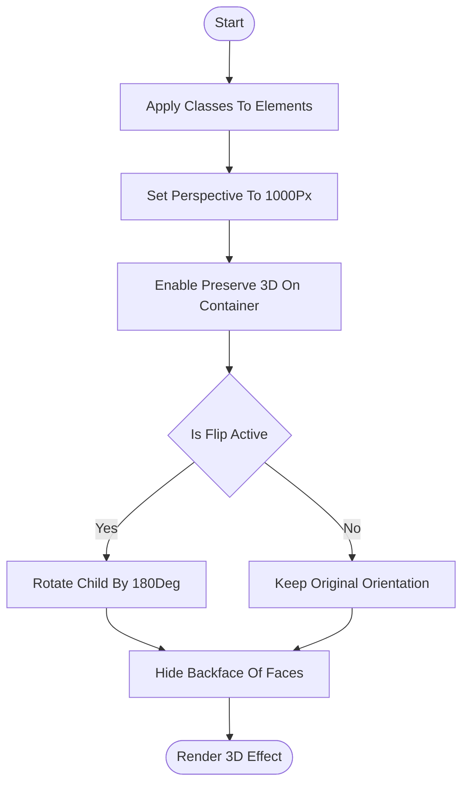

> **[ADDED]** — New file since last run (2026-03-05)

# src\App.css

## Summary
This CSS file provides a small set of utility classes to enable simple 3D transform and flip effects. It centralizes perspective, 3D preservation, backface visibility, and a 180-degree Y-rotation so HTML elements can be composed into card-flip or other 3D visual patterns.



## Core Functionality

### .perspective-1000 — set container perspective
```css
.perspective-1000 {
  perspective: 1000px;
}
```
Purpose: Establishes a 3D perspective depth for descendant elements so 3D transforms produce visible parallax. Use on the parent wrapper of transformed children.

### .transform-style-preserve-3d — enable child 3D rendering
```css
.transform-style-preserve-3d {
  transform-style: preserve-3d;
}
```
Purpose: Ensures child elements retain their 3D position when their parent is transformed. Required on containers when composing multi-element 3D scenes.

### .backface-hidden — hide rear faces during rotation
```css
.backface-hidden {
  backface-visibility: hidden;
}
```
Purpose: Prevents the backside of rotated faces from being visible during flips, avoiding mirrored content showing through.

### .rotate-y-180 — rotate an element around Y axis
```css
.rotate-y-180 {
  transform: rotateY(180deg);
}
```
Purpose: Applies a 180-degree Y-axis rotation to create the flipped state of an element, commonly used for the back face of a card.

## Improvement Recommendations
- Add vendor-prefixed fallbacks (e.g., -webkit-backface-visibility, -webkit-transform-style) to improve cross-browser compatibility for older mobile browsers.  
- Expose CSS custom properties for perspective and rotation (e.g., --perspective, --rotate-y) to make the utilities easier to customize without creating new classes.  
- Include a short usage comment or example in the file showing the parent/child class composition (container with perspective + child with rotate and backface hidden) to clarify intended markup usage.

<!--S2D_RUNTIME_SERVICES:{"services":[]}-->