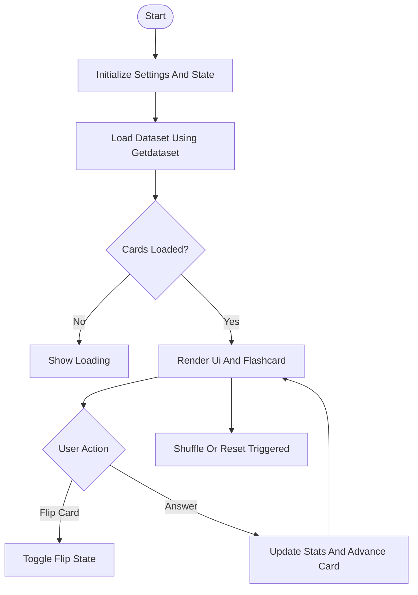

> **[ADDED]** — New file since last run (2026-03-05)

# src\App.jsx

## Summary
This file implements a single-page React flashcard app for learning Hiragana and Katakana. It provides the main UI and logic (settings modal, shuffling, flashcard flip/answer flow, stats) to study characters in three modes and two study directions using components like SettingsModal, Flashcard, and Stats.



### Core Functionality

1. shuffleArray — Fisher‑Yates shuffle for cards
```jsx
const shuffleArray = (array) => {
  const shuffled = [...array];
  for (let i = shuffled.length - 1; i > 0; i--) {
    const j = Math.floor(Math.random() * (i + 1));
    [shuffled[i], shuffled[j]] = [shuffled[j], shuffled[i]];
  }
  return shuffled;
};
```
- Randomizes an array in place (returns a shallow-copied shuffled array). Used whenever cards are loaded or reshuffled.

2. getDataSet — Select dataset by mode
```jsx
const getDataSet = (mode) => {
  switch (mode) {
    case 'hiragana': return HIRAGANA_DATA;
    case 'katakana': return KATAKANA_DATA;
    case 'mixed': return [...HIRAGANA_DATA, ...KATAKANA_DATA];
    default: return HIRAGANA_DATA;
  }
};
```
- Returns the appropriate character list based on `settings.mode`. Centralized dataset selection for loading and reshuffling.

3. SettingsModal — Settings UI and change handlers
```jsx
const SettingsModal = ({ isOpen, onClose, settings, onSettingsChange }) => {
  if (!isOpen) return null;
  const handleSettingChange = (key, value) => onSettingsChange({ ...settings, [key]: value });
  const handleBackdropClick = (e) => { if (e.target === e.currentTarget) onClose(); };
  return (
    <div onClick={handleBackdropClick}>
      ...
      <select value={settings.mode} onChange={(e)=>handleSettingChange('mode', e.target.value)}>...</select>
      ...
    </div>
  );
};
```
- Provides modal UI to change mode and study direction. Uses backdrop click to close and calls back onSettingsChange with merged settings.

4. Flashcard — Visual flip card component
```jsx
const Flashcard = ({ card, isFlipped, onFlip, direction }) => {
  const front = direction === 'char-to-romaji' ? card.char : card.romaji;
  const back = direction === 'char-to-romaji' ? card.romaji : card.char;
  return (
    <div onClick={onFlip} className="...">
      <div className={`... ${isFlipped ? 'rotate-y-180' : ''}`}>
        <div className="front"> <span>{front}</span> </div>
        <div className="back"> <span>{back}</span> </div>
      </div>
    </div>
  );
};
```
- Displays front/back based on study direction and toggles flip state when clicked. CSS classes drive the 3D flip animation.

5. Dataset load effect — initialize and reset on settings change
```jsx
useEffect(() => {
  const dataSet = getDataSet(settings.mode);
  const shuffledCards = shuffleArray(dataSet);
  setCards(shuffledCards);
  setCurrentIndex(0);
  setIsFlipped(false);
  setStats({ correct: 0, total: 0 });
}, [settings]);
```
- Rebuilds and shuffles the card list whenever settings change and resets progress and stats.

6. handleAnswer — record answer and advance or reshuffle
```jsx
const handleAnswer = useCallback((isCorrect) => {
  setStats(prev => ({ correct: prev.correct + (isCorrect ? 1 : 0), total: prev.total + 1 }));
  setIsFlipped(false);
  setTimeout(() => {
    if (currentIndex < cards.length - 1) {
      setCurrentIndex(prev => prev + 1);
    } else {
      const dataSet = getDataSet(settings.mode);
      setCards(shuffleArray(dataSet));
      setCurrentIndex(0);
    }
  }, 300);
}, [currentIndex, cards.length, settings.mode]);
```
- Updates stats, closes the card, then advances to the next card or reshuffles when reaching the end. Uses a short timeout to allow UI transition.

7. Keyboard shortcuts effect — space to flip, 1/2 to mark
```jsx
useEffect(() => {
  const handleKeyPress = (e) => {
    if (e.code === 'Space') { e.preventDefault(); setIsFlipped(prev => !prev); }
    if ((e.key === '1' || e.key === '2') && isFlipped) {
      e.preventDefault();
      handleAnswerRef.current(e.key === '2');
    }
  };
  window.addEventListener('keydown', handleKeyPress);
  return () => window.removeEventListener('keydown', handleKeyPress);
}, [isFlipped]);
```
- Adds global keyboard handling for accessibility and quicker review. Uses a ref to ensure latest handleAnswer is invoked.

### Improvement Recommendations
- Add TypeScript or PropTypes and more explicit types for props/state to improve maintainability and catch type errors early.
- Persist progress and settings to localStorage so users keep stats and mode between sessions; consider adding explicit reset confirmation.
- Extract datasets into separate JSON files and add unit tests for shuffleArray, getDataSet, and navigation logic to ensure deterministic behavior.

<!--S2D_RUNTIME_SERVICES:{"services":[]}-->