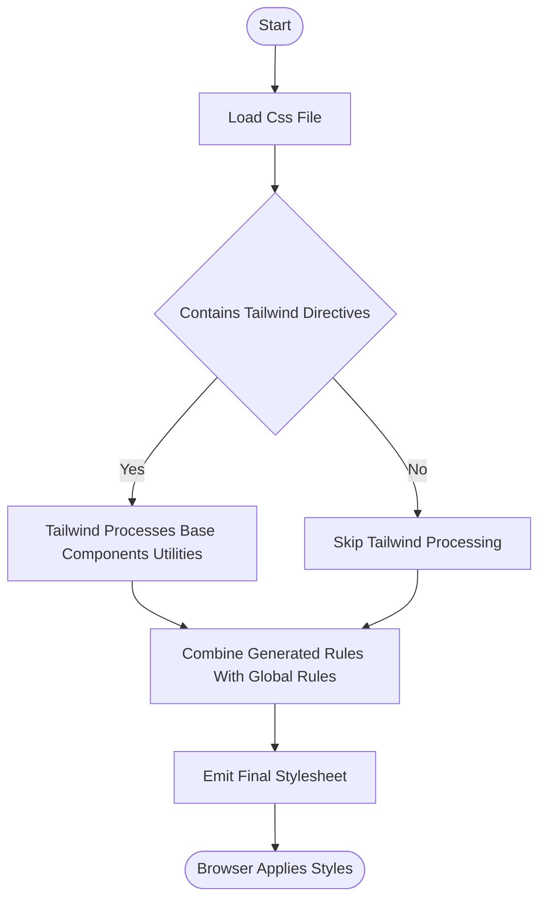

> **[ADDED]** — New file since last run (2026-03-05)

# src\index.css

## Summary
This CSS entry file loads Tailwind layers and defines a small global reset for the application. It centralizes Tailwind base, component, and utility injection so the build pipeline can generate the final stylesheet, and it sets a consistent body margin and font stack for the app.



## Core Functionality

### Tailwind layer inclusion
1. Purpose: Instructs the Tailwind processor to inject base styles, components, and utility classes into the final build.
```css
@tailwind base;
@tailwind components;
@tailwind utilities;
```
This triggers the build tool (PostCSS with Tailwind) to generate the framework CSS from configuration and plugins. It is the primary hook for Tailwind's output in this project.

### Global body rule
1. Purpose: Provide a minimal global reset and a cross-platform font stack for the application.
```css
body {
  margin: 0;
  font-family: -apple-system, BlinkMacSystemFont, 'Segoe UI', 'Roboto', sans-serif;
}
```
This rule removes default body margins and sets a common system font stack to ensure consistent typography across platforms and browsers.

## Improvement Recommendations
- Add an explicit CSS reset or include `@import 'normalize.css'` (or include Tailwind's preflight) to normalize more browser defaults and reduce cross-browser layout variance.
- Define and use CSS custom properties for fonts and spacing to make theme adjustments and overrides easier across components.
- Document expected Tailwind configuration (e.g., custom fonts or plugins) in a top-of-file comment so maintainers know build assumptions.

<!--S2D_RUNTIME_SERVICES:{"services":[]}-->