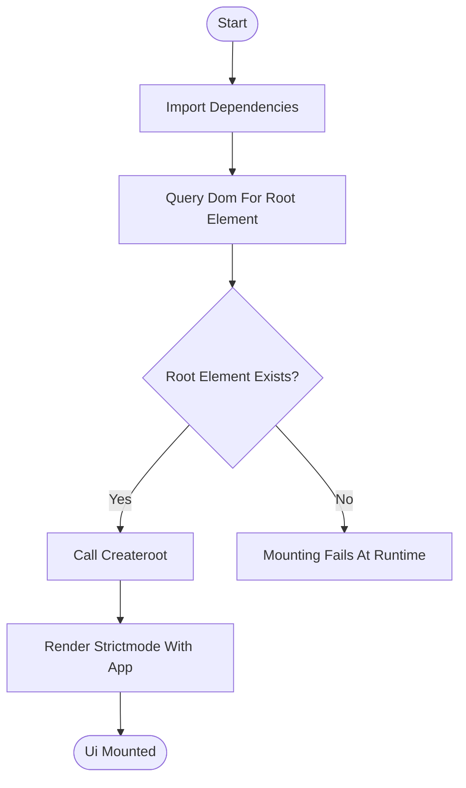

> **[ADDED]** — New file since last run (2026-03-05)

# src\main.jsx

## Summary
This file bootstraps the React application by locating the DOM mount node and rendering the root React component. It exists to attach the App component into the page and enable React StrictMode during development using `createRoot` and `StrictMode`.



## Core Functionality

### Imports and assets
1. Purpose: Bring in React primitives, the DOM renderer, CSS, and the top-level App component.
```jsx
import { StrictMode } from 'react'
import { createRoot } from 'react-dom/client'
import './index.css'
import App from './App.jsx'
```
- These imports provide the rendering API and the component tree entry point. The CSS import applies global styles before render.

### Mount and render
1. Purpose: Create a root renderer and mount the App inside React StrictMode.
```jsx
createRoot(document.getElementById('root')).render(
  <StrictMode>
    <App />
  </StrictMode>,
)
```
- Calls `createRoot` with the DOM node found by id "root" and renders the `App` component wrapped in `StrictMode`. No explicit guard or error handling is present if the DOM node is missing.

## Improvement Recommendations
- Add a guard that checks for the mount element and logs a clear error or throws a controlled exception to avoid an obscure runtime failure:
  - Example: const rootEl = `document.getElementById`('root'); if (!rootEl) { `console.error`('Mount target not found'); return; }
- Make the mount target configurable and document it; extract the mount id to a constant or environment variable to simplify testing and reuse.
- Add lightweight mount/unmount handling or HMR hooks for development and include a simple smoke test that asserts the root node receives children after rendering.

<!--S2D_RUNTIME_SERVICES:{"services":[]}-->